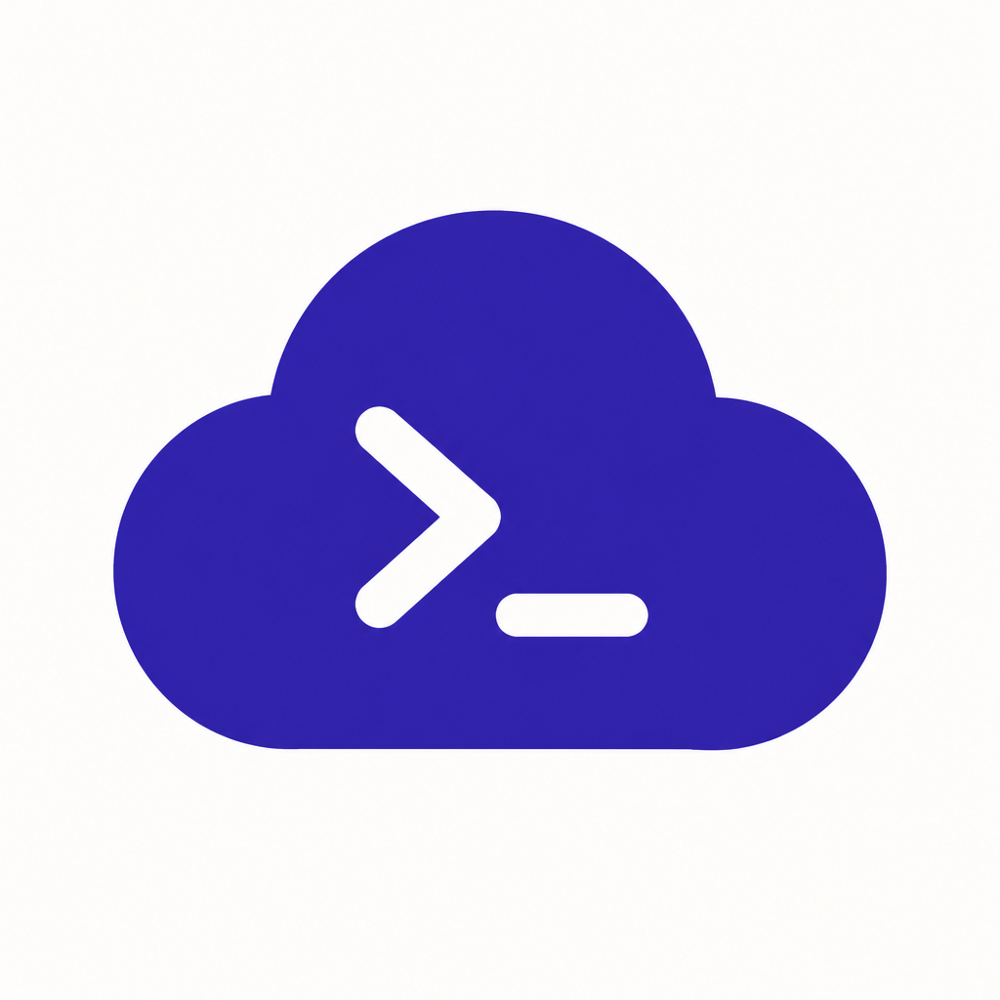

<p align="center"></p>

<h1 align="center">Cloud Code</h1>

<p align="center">Move a local Claude Code session to the cloud, keep working on it from any device, then bring the work back.</p>

---

You're deep in a Claude Code session on your laptop, and you need to leave. Say **"move this to the cloud"**. Cloud
Code packs up the project, your uncommitted work, what the conversation knows and the connections it uses. It starts
a [cloud session](https://code.claude.com/docs/en/claude-code-on-the-web) that picks up exactly where you stopped.
Open it on your phone (Claude app → **Code**), in a browser at claude.ai/code, or on another computer. It keeps
running with the laptop closed. Back at your desk, say **"bring it back"** and the cloud's commits land in your
local checkout.

## Install

In Claude Code:

```
/plugin marketplace add PandaPlayz2373/cloud-code
/plugin install cloud-code@cloud-code
```

You need:
- Claude Code signed in with a claude.ai account on a plan that includes cloud sessions (Pro, Max, Team or
  Enterprise). An API key won't work.
- `git`, and the [GitHub CLI](https://cli.github.com) signed in (`gh auth login`). Cloud sessions clone from GitHub.
- Python 3.8+. On Windows, Cloud Code installs `pywinpty` the first time it launches a session.

## Use

Just ask, in any session:

| You say | What happens |
|---|---|
| "move this to the cloud" / "make this a cloud session" | the full handoff below, ending with a link |
| "what's the cloud session doing?" | status, environment and the branch it pushed |
| "tell the cloud session to run the tests" | queues a message into it |
| "bring it back" / "pull the cloud changes" | merges the cloud session's branch into your local checkout |

## What it carries over

A cloud session only knows what's in the repo and its cloud environment. Cloud Code makes sure that's everything:

1. **The code.** It creates a private GitHub repo if there isn't one, then commits and pushes your uncommitted work.
   It scans for secrets before every push, and secrets never go into git.
2. **The conversation.** Claude writes `.claude/cloud-handoff.md` from the session: the goal, decisions, current
   state, next steps, gotchas, and what's only available on your machine. The cloud session reads it first.
3. **Connections.** claude.ai connectors follow your account automatically. Local MCP servers that the work needs
   get added to the project's `.mcp.json`, and user-level skills and agents get copied into the project.
4. **Setup.** Dependencies go into a SessionStart hook in the repo, so every cloud session installs them.
5. **Network access and keys.** Claude picks or helps you create a cloud environment. API keys become
   [network secrets](https://code.claude.com/docs/en/cloud-environments#add-network-secrets): Anthropic's proxy
   attaches them to requests, so the session can use a key without ever seeing it. Creating an environment or a
   secret is the one step that happens in the claude.ai web UI. Claude tells you exactly what to paste where.
6. **Launch and check.** It starts the session, pins the environment for the project, and checks the session can
   actually do the work before it gives you the link.

## The helper script

The skill drives `skills/cloud-code/scripts/cloudcode.py`, which you can also run yourself:

```
python cloudcode.py check                         # sign-in, cloud access, git, gh
python cloudcode.py envs                          # your cloud environments
python cloudcode.py pin <project> <env_id>        # use that environment for this project's cloud sessions
python cloudcode.py launch <project> <prompt.md>  # start a cloud session, prints its link
python cloudcode.py status <session>              # state, environment, branch
python cloudcode.py send <session> "<message>"    # follow-up message
python cloudcode.py pull <session> [<project>]    # merge the session's branch locally
```

It's standard-library Python. It uses Claude Code's own sign-in and never asks for or stores a key.
`claude --cloud` refuses to run without a terminal, so `launch` gives it a pseudo-terminal. It answers the folder
trust prompt only for the project you asked to send.

## Limits

- Cloud sessions use your plan's normal usage limits.
- A VM that sits idle gets reclaimed. Reopening the session restores the conversation, but not background
  processes.
- Anything that only exists on your machine stays there: local databases, hardware, other computers on your
  network, your browser. The handoff note says what's missing and what to do instead.
- To continue the *conversation* locally (not just the code), run `claude --teleport <session-id>` in the project.

## License

MIT
